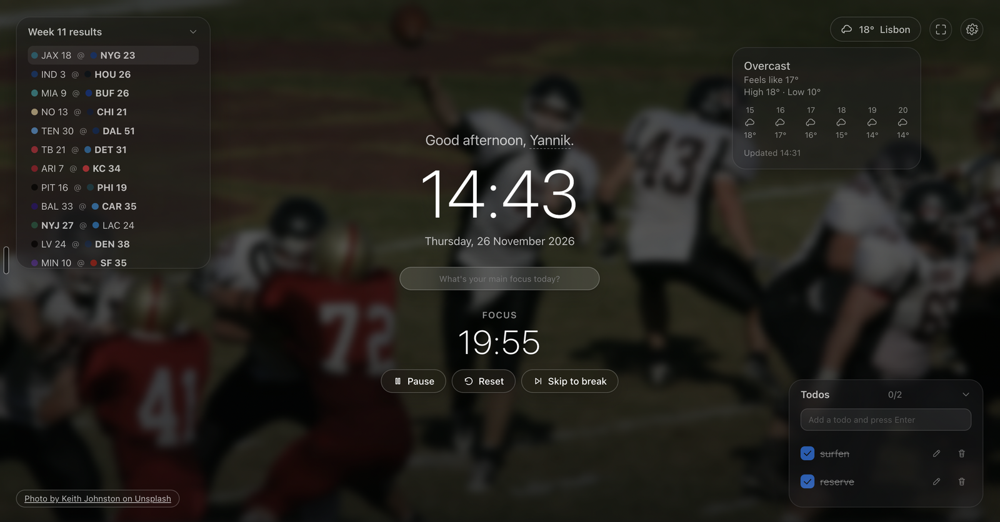

# Momentum Lite

A Chrome extension that replaces the new tab page with a calm dashboard: a greeting and clock, todos, a daily main focus with a silent focus timer, football background photos, last week's NFL results and the local weather. My light version of [Momentum](https://momentumdash.com).


*A new tab: NFL results, greeting and clock, the focus timer running, the weather panel and todos, over a bundled Unsplash photo*

## Purpose

This is my individual project on building a browser extension, from idea to installation. The brief was a light version of Momentum, with four requirements I set as my tests:

1. Opening a new tab shows the extension.
2. The time is correct for my location.
3. I can add, edit and remove todos.
4. Todos are still there after a refresh.

On top of that I added focus mode (without any sound, a deliberate choice), live NFL scores, weather, a settings panel with my own background photos, and a readable "glass" design over any photo.

| Feature | What it does |
|---|---|
| **Greeting and clock** | "Good morning / afternoon / evening, <name>", the time and the date, from the computer's own clock and time zone. The name is asked for once and can be edited by clicking it. |
| **Todos** | Add, edit, tick off and delete. Saved between visits and kept in sync across open tabs. |
| **Main focus** | "What's your main focus today?" One focus per day, which you can tick off; it resets the next day. |
| **Focus timer** | 25 / 5 minute focus and break timer (lengths adjustable). Keeps running correctly through refreshes, closed tabs and several open tabs. When it ends, the signal is visual only: a banner and the tab title. |
| **Distraction-free view** | One button (or the `F` key) hides everything except the background, clock, focus and timer. |
| **Background photos** | Nine bundled football photos, one per day, with the photographer credited on screen. Or upload your own. |
| **NFL scores** | Last week's results, with your favourite team pinned to the top. |
| **Weather** | Current weather and the next hours for a city you choose, in °C or °F. |
| **Settings** | Name, timer lengths, background source and photo uploads, weather city and unit, favourite team. |

## Data collection

The extension uses three outside sources. None needs an API key or account. They are listed in `manifest.json` as the only websites the extension may contact.

| Source | What for | How often |
|---|---|---|
| [Open-Meteo geocoding API](https://open-meteo.com/en/docs/geocoding-api) | Turns the city you type into coordinates | Only while you search for a city |
| [Open-Meteo forecast API](https://open-meteo.com/en/docs) | Current weather and hourly forecast | At most every 30 minutes |
| ESPN scoreboard feed (`site.api.espn.com`) | Last week's NFL results | At most every 3 hours |

The background photos are bundled in `images/` (no network access needed). Everything else comes from what you enter: your name, todos, main focus, settings and any photos you upload.

Nothing is sent anywhere else: there are no analytics, no accounts and no server of my own. The weather request contains the coordinates of the city you chose, which is unavoidable for a forecast.

## Data persistence

All data stays in your browser. There are three storage areas:

| Storage | What is stored | Notes |
|---|---|---|
| `chrome.storage.sync` | Your name, timer lengths, background source, weather city and unit, favourite NFL team | Small settings. If Chrome sync is switched on, Chrome copies these to your Google account so they follow you to other computers. |
| `chrome.storage.local` | Todos, today's main focus, timer state, distraction-free on/off, today's background choice, cached weather and NFL results | Stays on this computer. The caches let the widgets show the last known data when you are offline. |
| IndexedDB | Photos you upload as backgrounds | Stays on this computer. Photos are scaled down to at most 2560 px, re-encoded and limited to 30. |

Uninstalling the extension removes its stored data. None of it is ever stored in this repository.

## User interaction

Everything happens on the new tab page:

1. **First run:** the page asks for your name.
2. **Every new tab:** greeting and clock in the middle, todos at the bottom right, NFL results at the top left, weather and settings at the top right.
3. **Focus:** type your main focus and press Enter, then start the timer. Tick the focus off when it is done.
4. **Distraction-free:** the expand icon (top right) or `F` hides the panels.
5. **Settings (gear icon):** change your name and timer lengths, upload photos (button or drag and drop), choose bundled or your own photos, pick a weather city and unit, and choose a favourite team.
6. Click the weather pill for the forecast, and the NFL panel header to collapse it.

## Setup

Requirements: Google Chrome (other Chromium browsers such as Edge or Brave should work too, but were not tested). No API keys, accounts, build step or installation of packages.

1. Download the code: `git clone https://github.com/YannikNMody/momentum.git` (or *Code → Download ZIP* on GitHub, then unzip).
2. Open `chrome://extensions`.
3. Switch on **Developer mode** (top right).
4. Click **Load unpacked** and select the `momentum` folder.
5. Open a new tab. If Chrome asks whether to keep the changed new tab page, choose **Keep it**.

Only one extension can control the new tab page, so switch off the original Momentum or similar extensions while trying it.

After changing any file, click the reload arrow on the extension's card in `chrome://extensions`.

### Testing

- **Manual test plan:** [TESTING.md](TESTING.md) lists steps and expected results for every feature, including edge cases (offline, two tabs open, a new day). I ran it myself in Chrome.
- **Readability check:** `python3 tests/contrast_check.py` checks the text contrast of every glass surface over black, white, grey, two-tone and noisy test images (`tests/fixtures/`), against the WCAG 2.1 thresholds. It needs only Python 3, no packages. `tests/generate_fixtures.py` recreates the test images.

## Learning

**Making state survive refreshes and multiple tabs**

- A new tab page is opened and closed all the time, often several at once, so anything kept only in memory gets lost. We identified two places where this would break before building them.
- **Timer:** a countdown kept in memory resets on every refresh. The timer stores its *end time* instead of the time left and recalculates from the clock on every load, so it survives refreshes, closed tabs and several open tabs.
- **Todos:** with two tabs open, each would save its own copy of the list and the second would overwrite the first, which looks like "my todos disappeared". Every tab now listens for storage changes (`chrome.storage.onChanged`) and updates itself. "Two tabs open at once" became one of my tests.
- **Where to store it:** todos go in `chrome.storage.local`, not `sync`, because `sync` limits each stored item to 8 KB and a long list would silently stop saving.
- **Testing:** Claude Code's first check only *read* the code, so I ran the tests in Chrome myself. While preparing this submission, a screenshot showed a bug that reading the code had not caught (all timer buttons visible at once).

## Limitations and assistance

**Limitations**

- **Not on the Chrome Web Store.** It is installed with "Load unpacked" in developer mode.
- **The NFL feed is unofficial.** ESPN's scoreboard address is not a documented public API with terms for outside use. It can change or disappear without notice; the panel then shows the last saved results or hides itself, and the rest of the page keeps working.
- **No sound, on purpose.** Momentum's ambient soundscapes were left out; the timer's end is visual only.
- **Chrome only.** It uses Chrome extension APIs, so it does not work in Firefox or Safari.
- **No automated browser tests.** Features were tested by hand with `TESTING.md`; only the contrast check is a script.
- **Found during submission prep:** the timer showed Start, Pause and Resume at the same time, because the stylesheet overrode the HTML `hidden` attribute. Fixed with one CSS rule and retested by hand; `TESTING.md` now has a check for it.
- **Left out:** quote of the day, a links bar and a search box, which were considered as extras.

**AI assistance**

All code in this project was written by AI. I used Claude chat (Opus 5.5) to brainstorm, plan the features and design, and write implementation prompts and guidelines. Claude Code (Sonnet 5) implemented, ran, tested and committed the changes in my repository. My part was deciding what to build, making the calls when trade-offs came up, testing the results by hand, and reviewing what went into the repo. Commits made by Claude during submission prep are authored as "Claude". The README text, including the Learning section, was drafted by Claude from my project chats and notes; I reviewed and approved it.

**Other sources**

- Background photos from [Unsplash](https://unsplash.com), used under the [Unsplash License](https://unsplash.com/license). Each photographer is listed in [`images/credits.json`](images/credits.json) and credited on screen.
- Weather data by [Open-Meteo](https://open-meteo.com) (CC BY 4.0).
- NFL results from ESPN's public scoreboard feed (see Limitations). Teams are shown as abbreviations and colours, not logos.
- No libraries, frameworks, tutorials or external code: plain HTML, CSS and JavaScript.

## Technical details

```
manifest.json        Manifest V3: replaces the new tab page; permissions: storage + three API hosts
newtab.html          The page (no inline scripts, as Manifest V3 requires)
newtab.js            Starts every module
styles.css           "Liquid glass" design system: spacing and type scale, three glass levels
js/                  One module per feature: clock, greeting, todos, focus, timer, background,
                     photoStore, imageProcessing, nfl / nfl-widget, weather / weather-widget,
                     settings, distraction-free, scrim (readability), storage (chrome.storage wrapper)
images/              Bundled background photos + credits.json
tests/               Contrast check and its test images
TESTING.md           Manual test plan
docs/screenshots/    Screenshots used in this README
```

Design decisions worth knowing:

- **Plain HTML, CSS and JavaScript** with ES modules: no framework and no build step, so the folder you load is exactly the code in the repo.
- **The timer stores its end time, not the time left.** Every page recalculates from the clock, so refreshes, closed tabs and several tabs all show the same, correct countdown.
- **Tabs listen to each other.** Todos and the timer react to `chrome.storage.onChanged`, so a change in one tab appears in all others instead of being overwritten.
- **Keyless APIs only.** An API key inside an extension can be read by anyone who installs it, so only services without keys are used.
- **Fails soft.** If a feed, a photo or the photo storage is unavailable, that part hides or falls back and the rest of the page keeps working.

## Audit

Before publishing, the repository was checked for secrets, personal data, unnecessary files and documentation gaps with an AI-assisted audit. See [AUDIT.md](AUDIT.md).

## License

No license: coursework, published for grading. All rights reserved. The bundled photos remain under the Unsplash License.
